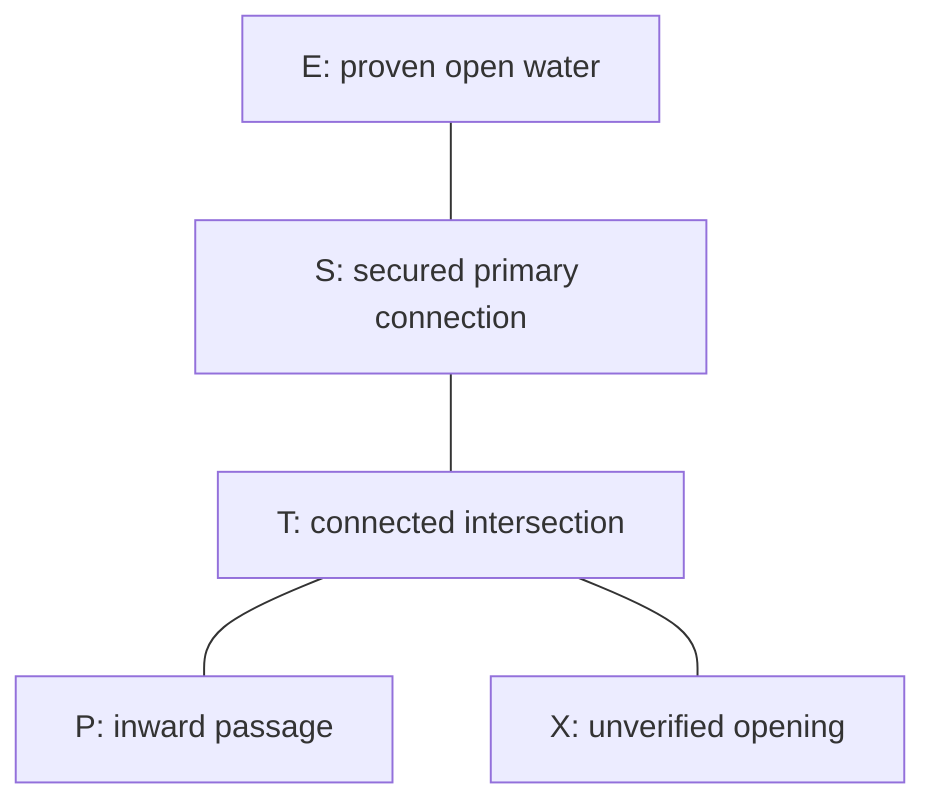

# Fictional return-route model

status: draft
objective: NAV-01, NAV-02

This is a conceptual network, not a site map. Edges show route connections only: no distances, bearing, depth, scale, installation geometry or accessibility can be inferred. The case assumes a trained, owned continuous connection for every required temporary segment. The team entered via E–S–T–P and uses personal exit-side markers at decisions. A system arrow at T points toward X; X is not a verified exit.

Text equivalent: E connects to S. S connects to T. T has branches toward P and X. The team came from E through S and T into P. Its proven return is P to T to S to E. The arrow toward X does not establish that X can be used. A line connection at T provides continuity but not by itself the correct return direction.

Teaching use: first reveal only E–S–T–P to teach continuity; then reveal X and the arrow information to teach direction. Ask the learner to describe the return before revealing it. If diagram rendering fails, present the relationship sentences. All mandatory reasoning remains available in text.
